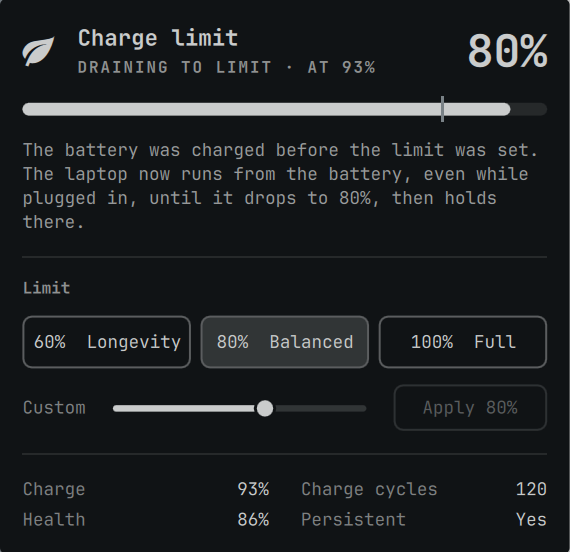

# Charge Limit (assem.charge-limit)

Caps battery charging to preserve battery health, using **asusctl**.



## Install

```bash
omarchy plugin add https://github.com/Assem130/omarchy-charge-limit.git --enable
```

Requires an ASUS laptop whose firmware supports a charge limit, and Omarchy 4.

**Dependency:** [`asusctl`](https://gitlab.com/asus-linux/asusctl) (Arch `extra` repo). If it is missing, the panel offers to install it with `pacman` after a password prompt.
See [SECURITY.md](SECURITY.md) for exactly what the plugin runs.

## Use

- Bar icon 󰌪 shows the active limit; click it for presets (60 / 80 / 100%) or a custom 50–100% value.
- Every change runs `asusctl battery limit <value>`. `asusd` saves it in
  `/etc/asusd/asusd.ron` and restores it at boot and after waking from sleep.
- Without asusctl, the panel offers **Install asusctl** (one password prompt).
- Charge, health and cycle count are read from the kernel's battery info, since asusctl doesn't report them.

CLI: `bin/charge-limit status | set <20-100> | setup | uninstall`.

## Remove

```bash
~/.config/omarchy/plugins/assem.charge-limit/bin/charge-limit uninstall   # limit back to 100%
omarchy plugin remove assem.charge-limit
```

The plugin changes nothing on its own: the limit only changes when you click a preset or Apply.
`asusctl` stays installed; remove it with `sudo pacman -R asusctl` if you no longer want it.

## License

MIT, see [LICENSE](LICENSE).
